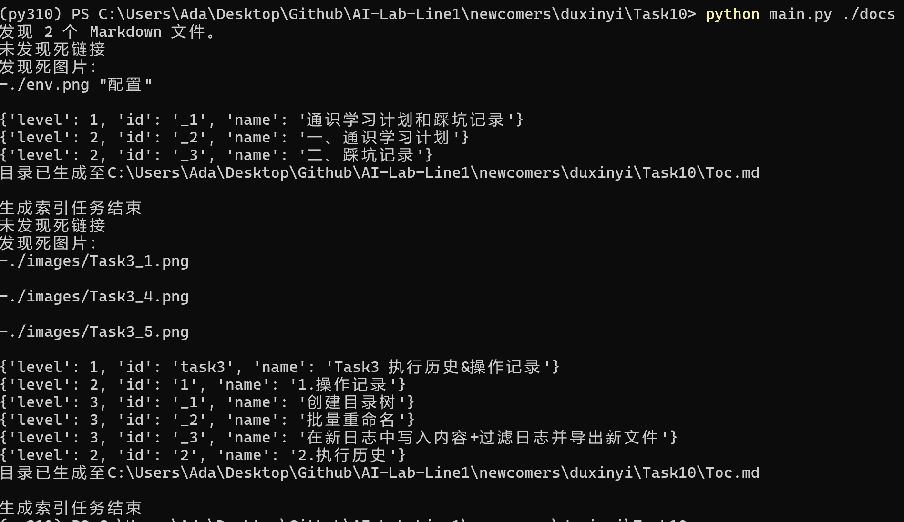
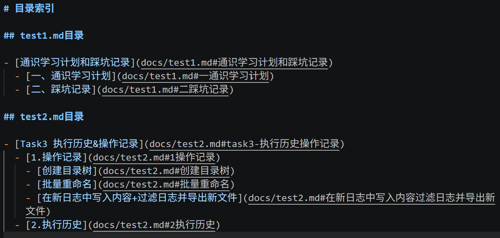

# 文档工程工具

## 项目介绍

1. 主要功能：扫描指定文件夹下的所有markdown文档，检测死链接和损坏图片，统计标题层级结构，生成良好的目录索引。
2. 组成：[main.py](./main.py)是项目入口，[check.py](./check.py)负责检测死链接和损坏图片，[analyze_headings](./analyze.headings.py)统计标题层级结构,[generate_toc](./generate_toc.py)成良好的目录索引
3. 输入参数与输出：扫描的文件夹需要在命令行内输入；目录索引默认以markdown格式，输出在main.py同级目录。

## 输出展示

### conda虚拟环境下输出

测试时生成的目录索引，详见[目录索引](./Toc.md)

### 容器化运行下输出

